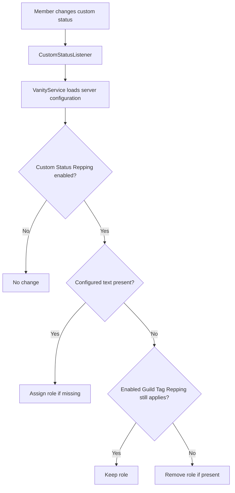
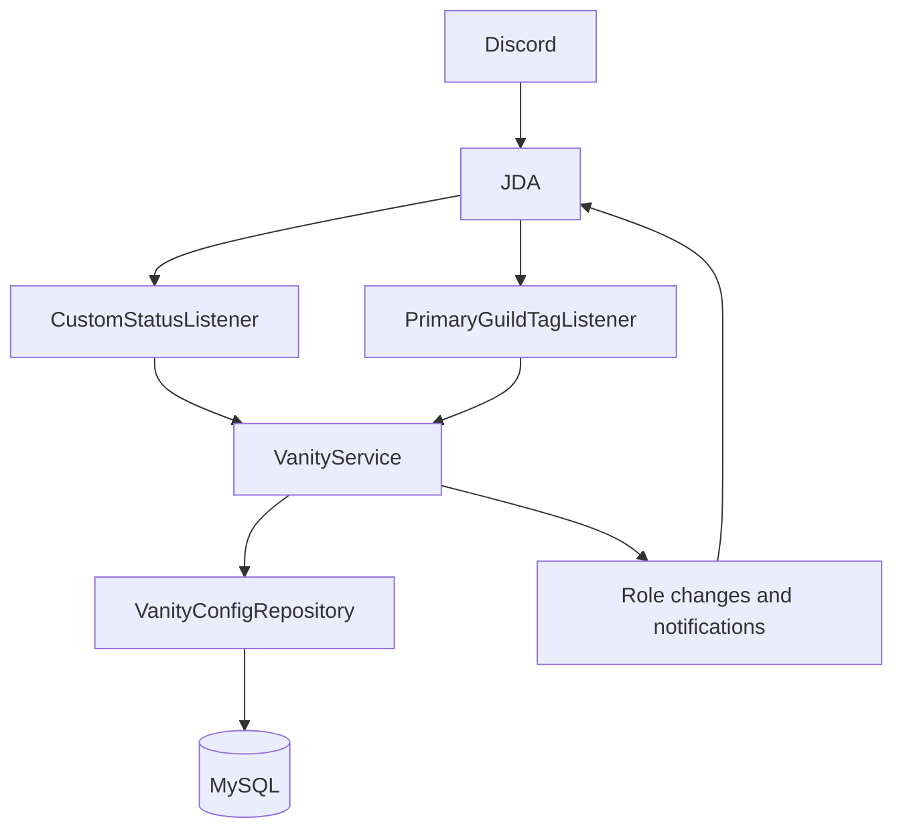

# Yoko — Discord Community Bot

Yoko is an event-driven Discord bot built with Java 17, JDA and MySQL. It automates role assignment for members who represent a Discord server through their custom status or primary guild tag.

Beyond its functionality, Yoko is a personal software engineering project through which I explore event-driven programming, application architecture, database integration and incremental refactoring.

This repository provides public documentation of the project. The application source code is maintained in a private repository.

> **Project status:** Active development. Repping functionality is being refined, Vanity Slash Commands are in development, and personal features are planned to move into a separate application.

## Current Features

### Custom Status Repping

Yoko checks whether a member's Discord custom status contains the vanity text configured for their server, such as `/cigarette`.

When the configured text is present, Yoko assigns the server's repping role. When the text is removed, Yoko checks whether the member still qualifies through Guild Tag Repping before removing the role.

### Guild Tag Repping

Yoko responds to changes to a user's primary guild and checks whether it matches a configured Discord server.

When a member represents that server through their primary guild tag, Yoko assigns its repping role. If the member changes or removes the tag, Yoko checks whether they still qualify through Custom Status Repping before removing the role.

### Server-Specific Configuration

Repping configuration is stored in MySQL and includes:

- Vanity text to look for in custom statuses
- Repping role
- Notification channel
- Perks channel referenced in notification messages
- Separate settings to enable Custom Status Repping and Guild Tag Repping

Both repping methods use the same configured role within a server. Members keep this role while at least one enabled repping method still applies.

Configuration persistence is implemented. Managing this configuration through Vanity Slash Commands is currently in development.

### Repping Notifications

Yoko can send a notification to a configured server channel when a member starts repping. These messages mention the member and point them to the server's configured perks channel.

### Daily Reminders — Planned for Extraction

The current application also includes recurring daily reminders through the `/daily` command.

Users can specify a time, message and target text channel. Reminders are stored in MySQL and checked once per minute, using the `Europe/Zurich` time zone.

Daily Reminders are planned to move into a separate application as part of **The Great Split**.

## Development Roadmap

| Area | Status |
| --- | --- |
| Custom Status and Guild Tag Repping | Implemented; being refined |
| MySQL-backed repping configuration | Implemented |
| Vanity configuration Slash Commands | In development |
| Daily Reminders | Implemented; planned for extraction |
| Message and Embed Management | Planned after the split |
| Repping Analytics | Future exploration |
| Ticket System | Potential future feature |

### The Great Split

Let's call it **The Great Split** ( - ᴗ •́ ).

The goal is to separate community functionality from personal functionality into two independently maintainable and deployable applications.

**Yoko will continue to focus on community features:**

- Custom Status and Guild Tag Repping
- Server-specific configuration
- Community-related Slash Commands
- Future message and embed management

**A separate application will focus on personal features:**

- Daily Reminders
- Future personal productivity functionality

Daily Reminders are still part of the current codebase. The extraction has not yet been completed.

### Message and Embed Management

After the split, the next planned feature is allowing administrators to compose and send messages and embeds through Discord Slash Commands.

Initial command definitions exist, but this functionality is not yet complete.

### Future Ideas

These ideas are exploratory and are not part of the current implementation:

- **Repping Analytics:** Use Python to analyze repping activity, trends and statistics, with potential visualizations.
- **Automated Messages:** Extend message management with scheduled or automated messages.
- **Ticket System:** Explore support request management, potentially as a separate project.

## How Repping Works

Yoko reacts to relevant Discord events rather than repeatedly checking every member.

### Custom Status Updates

1. JDA delivers a `UserUpdateActivitiesEvent` to `CustomStatusListener`.
2. The listener delegates processing to `VanityService`.
3. The service loads the server's configuration from MySQL.
4. If Custom Status Repping is enabled, it checks whether the custom status contains the configured vanity text.
5. The service assigns the repping role or checks whether Guild Tag Repping still qualifies the member before removing it.

### Primary Guild Updates

1. JDA delivers a `UserUpdatePrimaryGuildEvent` to `PrimaryGuildTagListener`.
2. The listener delegates processing to `VanityService`.
3. The service checks configurations associated with the previous and new primary guilds.
4. Where Guild Tag Repping is enabled, the service assigns the corresponding role or checks Custom Status Repping before removing it.

## Architecture

Yoko is built as an event-driven Java application.

Dedicated JDA listeners delegate repping decisions to a shared `VanityService`. This service coordinates configuration access, role changes and repping notifications.

`VanityConfigRepository` handles database operations for server-specific repping configuration.

This diagram focuses on the community repping functionality. Daily Reminders currently use their own command handler, repository and scheduler, which are planned for extraction.

The architecture is evolving through incremental refactoring. Repping decisions are centralized in the service, while the service itself still works directly with JDA events and Discord objects.

## Technologies

- **Java 17** — Core application development
- **JDA 6.2.0** — Discord API integration and event handling
- **Apache Maven** — Build tooling and dependency management
- **MySQL / JDBC** — Persistence for repping configuration and daily reminders
- **SLF4J / Logback** — Application logging
- **dotenv-java** — Environment-based configuration
- **Git / GitHub** — Version control, documentation and development tracking

## Learning Focus

Yoko gives me a practical environment for developing and improving skills in:

- Processing asynchronous events
- Integrating with an external API
- Organizing listeners, services and repositories
- Persisting application data with SQL and JDBC
- Refactoring an existing application incrementally
- Separating features into independently maintainable applications
- Collaborating with AI coding assistants for code reviews, debugging and architecture while critically evaluating their suggestions

## Source Code

The application source code is maintained in a private repository.

This public repository documents Yoko's functionality, architecture and development direction. It does not contain the application source or a runnable distribution.

Source code access is available for review in connection with job applications or professional inquiries.

## Credits

- **Vanity Roles** — The Custom Status Repping feature was inspired by [Vanity Roles](https://vanityroles.xyz/).
- **Mermaid** — Architecture and flow diagrams use [Mermaid](https://mermaid.js.org/).
